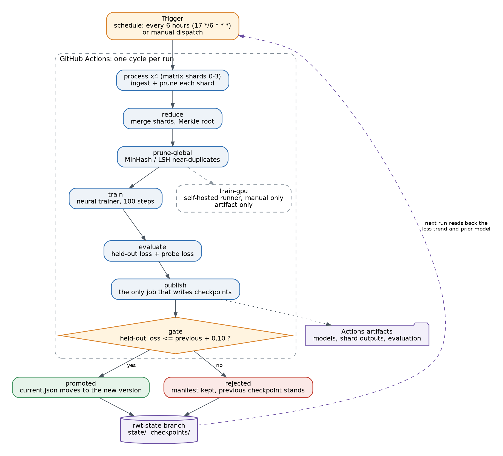
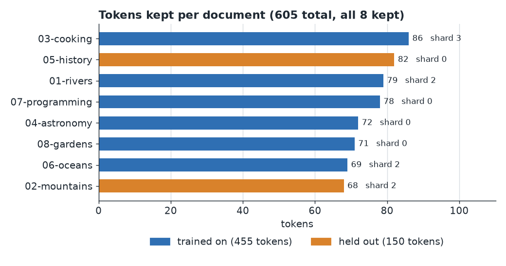
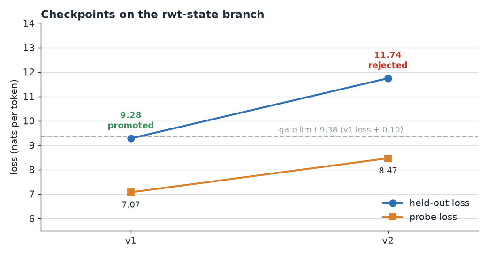
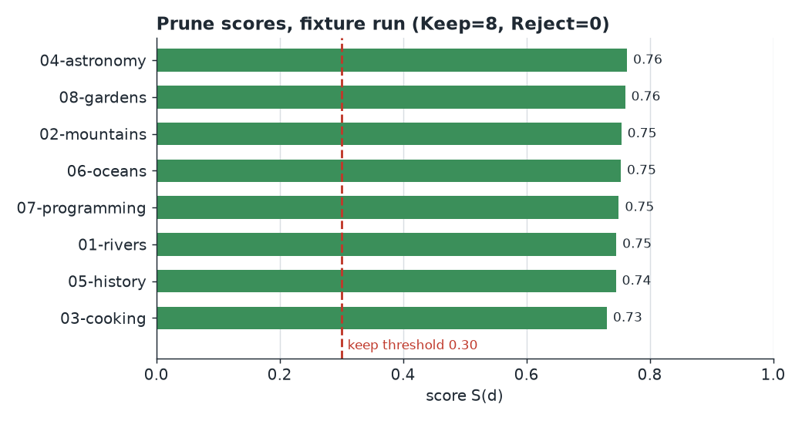

# Recursive Web Tensor

[](https://github.com/AHMADALIPARR/recursive-web-tensor/actions/workflows/rwt-cycle.yml)


**GitHub Actions as the control plane for a learning system that keeps pruning its own training data.**



## What it is

Most training setups run one giant job. This one doesn't.

Each Actions run does one small round of work and stops. It takes in documents, scores them, throws out the weak and duplicate ones, trains a small model on what is left, and checks the result. If the result is good, it saves a checkpoint. Then the next scheduled run picks up from there.

The loop happens across runs, not inside one. Nothing runs forever.

## How a round works

1. **Ingest.** Documents are read in, hashed with SHA-256 and split into four shards by the first byte of the hash.
2. **Score.** Every document gets a score from quality, novelty, information density and redundancy.
3. **Prune.** A document is kept if its score clears a threshold. The best documents in each category are always kept. Near-copies are folded into one. Unknown or banned licenses never reach training.
4. **Train.** A small neural net learns from the kept documents. It is written from scratch in Rust, with its own backprop and Adam.
5. **Evaluate.** The model is tested on held-out documents and on a few probe texts.
6. **Gate.** The new checkpoint is only promoted if its held-out loss is no worse than the last one plus 0.10. If not, the old checkpoint stays.

The threshold is not fixed. It starts at 0.30. It goes up by 0.02 when the last round improved the loss and down by 0.02 when it got worse. It stays between 0.15 and 0.50. So the data never gets pruned down to nothing.

The score is `S = 0.3*Q + 0.3*N + 0.2*I - 0.2*R`. The details are in [docs/scoring.md](docs/scoring.md).

## Latest checkpoint

The state lives on the `rwt-state` branch, not on `main`.

**v1, promoted on Oct 27, 2026 at 5:05 AM Pacific.** It is the first checkpoint, so it has no parent.

| | |
|---|---|
| Documents kept | 8 of 8 |
| Tokens kept | 605 (455 for training, 150 held out) |
| Held-out loss | 9.28 |
| Probe loss | 7.07 |
| Perplexity | 10,724 |
| Model | 18,642 weights, 338 tokens in the vocab |
| Model file | 373 KB |
| Merkle root | `8c684e44...a251d` |

The next run, at 5:17 AM Pacific, scored a held-out loss of 11.74. That is over the 9.38 limit, so the gate rejected it. Its manifest is saved as v2 and v1 is still the current checkpoint.







Each of these charts comes from the real files on `rwt-state`. The scores come from running the engine on the fixture corpus. [docs/tools/make_figures.py](docs/tools/make_figures.py) rebuilds all of them.

## Run it

You need Rust. The engine has no outside crates, so it builds offline.

```sh
cargo build --release --locked
./target/release/internet-token-engine --root /tmp/rwt-demo \
  cycle --corpus fixtures/corpus --probe-dir fixtures/probe --steps 0
```

That runs a full round on the eight fixture documents and writes `checkpoints/v1/`.

Check it end to end, with an independent hash check in Python:

```sh
sh scripts/e2e.sh
cargo test --release --locked
```

Commands: `ingest`, `prune`, `reduce`, `prune-global`, `train`, `evaluate`, `checkpoint`, `cycle`, `tokenizer`. Run the binary with no arguments to see the flags.

## The scheduled workflow

The workflow is [.github/workflows/rwt-cycle.yml](.github/workflows/rwt-cycle.yml). It runs at minute 17 of every sixth hour. You can also start it by hand:

```sh
gh workflow run rwt-cycle.yml
```

The jobs run in this order:

- `process` runs four shards at the same time. Each one ingests and prunes its own documents.
- `reduce` merges the shards and builds the Merkle root.
- `prune-global` finds near-duplicates that landed in different shards, using MinHash and LSH.
- `train` trains the model and uploads it as an artifact.
- `evaluate` measures loss on held-out and probe texts.
- `publish` runs the gate, writes the checkpoint and pushes `state/` and `checkpoints/` to `rwt-state`.

Only `publish` can write a checkpoint. It is the only job with write access.

There is also a `train-gpu` job for a self-hosted GPU runner. It only runs on a manual start with the `gpu` input on. It runs the same trainer today and only uploads an artifact. See [docs/runners.md](docs/runners.md).

## Where the data comes from

- Local text files, which is what the fixtures use.
- Common Crawl WARC records ([docs/warc.md](docs/warc.md)).
- URL manifests and DuckDuckGo discovery ([sources/](sources/)).

Licenses are checked at ingest and again at prune. Public domain, CC0, CC-BY, CC-BY-SA, MIT, Apache-2.0 and BSD are allowed. Proprietary and all-rights-reserved are rejected. Unknown ones are quarantined. Fetched text is only ever tokenized. It is never run.

## Repo layout

```
src/                  the engine (Rust): tokenizer, BPE, scoring, minhash, neural trainer, WARC
.github/workflows/    rwt-cycle.yml, the scheduled workflow
docs/                 architecture, scoring, pruning, tokenizer, neural, runners, WARC
docs/img/             the pictures in this README
docs/tools/           make_figures.py, which draws them
sources/              where documents come from, and the license policy
fixtures/             the small corpus, probe texts and sample WARC files
scripts/e2e.sh        full round plus independent checks
tests/                end-to-end tests
config.example.json   every setting with its default
```

## Where it stands

The corpus is eight small documents. The goal is 100 million tokens, and that is still ahead. The round, the gate and the state branch all work today.

## License

Dual licensed under AGPL-3.0 and the SnapKitty Opaque License.

## Author

Ahmad Ali Parr
